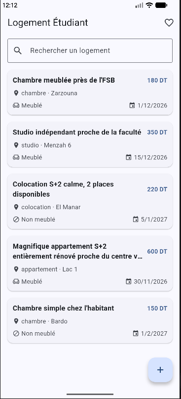
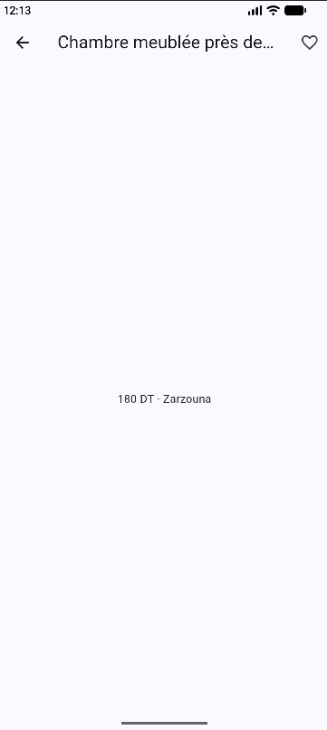
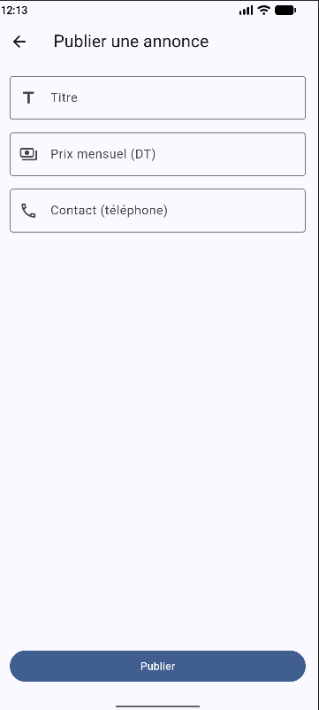
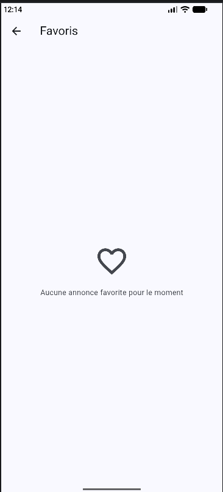

## Jalon J1 : squelette de l'application

Tous les écrans sont reliés entre eux et l'annonce touchée dans la liste est passée à l'écran Détail (EF1, EF2). Les données sont fictives (`lib/data/annonces_test.dart`), l'API arrive au jalon J2.

### Captures d'écran

<p>
  
  
  
  
</p>

De gauche à droite : Accueil, Détail, Publier une annonce, Favoris.

## Journal IA

Nous avons utilisé une seule conversation avec l'IA, partagée entre les deux membres du binôme : [Voir la conversation](https://claude.ai/chat/6787eb77-d656-4c6c-b39b-beaad20e1634)

### Schéma de navigation

```
                  touche une carte (passe l'Annonce)
            +-----------------------------------------> [ Détail ]
            |                                                |
            |                                                | icône cœur
            |                                                v
[ Accueil ] +-------- icône cœur ---------------------> [ Favoris ]
            |
            | bouton +
            v
   [ Publier une annonce ]
```

Liaisons :

- **Accueil → Détail** : touche sur une carte (`AnnonceCard`), l'objet `Annonce` est passé à l'écran.
- **Accueil → Publier** : bouton flottant `+`.
- **Accueil → Favoris** : icône cœur de la barre du haut.
- **Détail → Favoris** : icône cœur de la barre du haut.

Le retour se fait avec le bouton retour (`Navigator.pop`). Le 5e écran prévu, « Mes annonces », sera ajouté ensuite.

### Répartition du travail (J1)

**Ahmed Lahouel**

- Initialisation du projet Flutter
- Modèle `Annonce` (`models/annonce.dart`)
- Données de test (`data/annonces_test.dart`)
- Écran Détail (`screens/detail_screen.dart`)
- Écran Favoris (`screens/favoris_screen.dart`)
- Liens de l'Accueil et du Détail vers Favoris

**Bassem Ben Romdhane**

- Barre de recherche (`widgets/search_box.dart`)
- Carte d'annonce (`widgets/annonce_card.dart`)
- Formulaire de publication (`screens/publier_screen.dart`)
- Écran Accueil (`screens/accueil_screen.dart`)
- Point d'entrée et thème Material 3 (`main.dart`)
